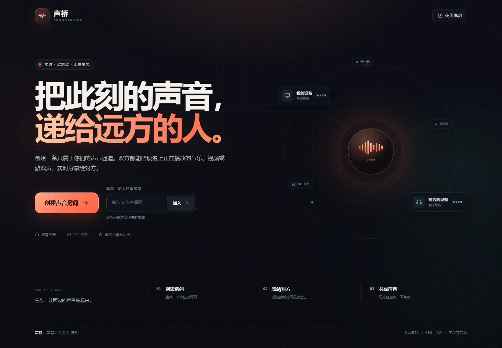
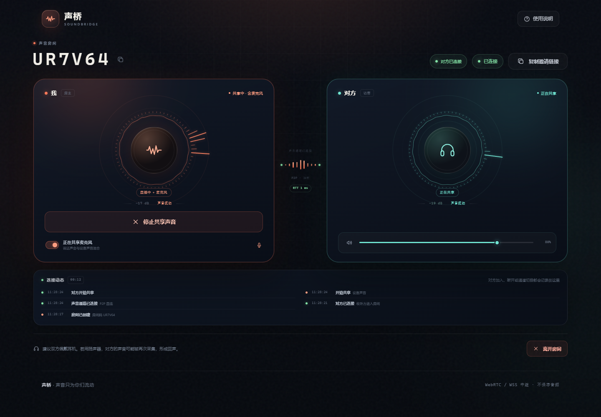
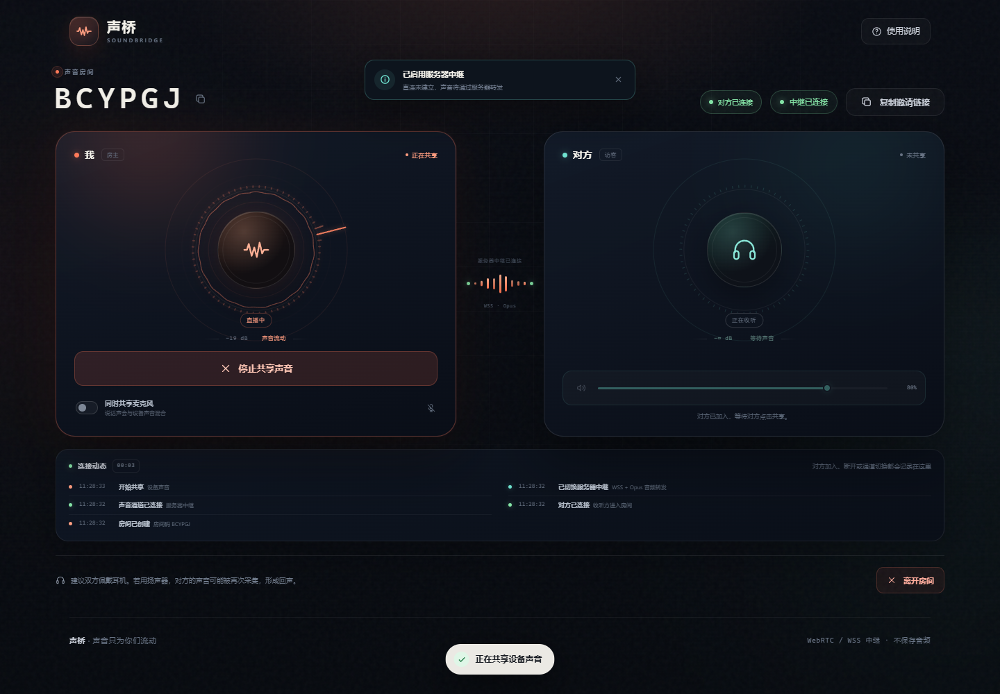

# 声桥 SoundBridge

> 把此刻的声音，递给远方的人。

声桥是一个可以自托管的双人实时声音共享应用。两个人在浏览器里打开同一个房间，各自点一下“共享我的设备声音”，就能双向听见对方设备正在播放的音乐、视频、游戏声或系统声音。

- 自动直连 / 中继：优先 WebRTC 点对点；6 秒内连不上时自动切换到服务器 WSS 中继（Opus），所以双方不在同一局域网也能听。
- 双向共享：双方可以同时共享，也可以只让一方共享。
- 可选麦克风：把麦克风与设备声音混合后一起发送，适合一起听歌、看片或语音陪伴。
- Android 手机共享端：通过 AudioPlaybackCapture 采集小说、音乐等 App 正在播放的声音，不需要把手机音频接到电脑；支持选择监听某个应用并随时切换，支持同时混入麦克风，内置环绕式音频节奏。
- 可视化音频节奏：频谱柱、波形、实时电平、节奏脉冲，收听方能直观看到共享方声音的起伏。
- 连接状态提醒：对方在线状态、加入/断开弹窗、连接动态时间线，Web 和 Android 共享端都有提醒。
- Cloudflare Workers 版本：静态资源、信令、房间和 Opus 中继全部运行在 Cloudflare 边缘，不需要电脑或手机常开，部署后获得长期 `workers.dev` 地址。
- 手机主机模式：Termux + ngrok 免费固定域名，不用电脑，手动启动，适合只想用手机的场景。
- 无需注册：创建房间后得到六位房间码和邀请链接。
- 单文件服务端 + 原生前端：运行时只依赖一个 ```ws``` 包，不需要构建。







---

## 快速开始

需要 **Node.js 20 或更高版本**。

```powershell
cd "C:\deep seek工作区\soundbridge"
npm install
npm start
```

打开终端里打印的地址：

```text
http://localhost:8787
```

如果之前执行过 `npm run cert`，终端还会打印一个 HTTPS 地址：

```text
https://localhost:8443
https://192.168.1.159:8443   ← 局域网邀请用这个
```

HTTP 8787 适合本机调试（localhost 被视为安全上下文）；局域网和远程使用请走 HTTPS 8443。

> **不在同一局域网也能用。** 如果 WebRTC 直连失败，声桥会在约 6 秒后自动切换到服务器中继，不需要公网 IP、端口映射或 TURN。服务器只转发 Opus 音频包，不保存音频。

同一台电脑上可以用两个浏览器标签页先试用：

1. 在第一个标签页点击“创建声音房间”，记下房间码。
2. 在第二个标签页打开邀请链接，或输入房间码加入。
3. 两边分别点击“共享我的设备声音”。
4. 在浏览器的共享弹窗中选择 **整个屏幕**，并勾选 **分享系统音频 / 分享音频**。

> 只共享音频时，浏览器仍然会显示“正在共享屏幕”。这是 Chrome / Edge 获取系统声音的必要条件。声桥不会发送视频轨道，也不会保存画面。

---

## 远程连接

### 1. HTTPS

浏览器只允许在 **安全上下文** 中调用屏幕 / 系统声音采集：

- ```http://localhost``` 和 ```http://127.0.0.1``` 被视为安全上下文，可以直接采集。
- 通过局域网 IP 或公网域名访问时，必须使用 **HTTPS**。

#### 方式 A：局域网自签名证书（最快）

```powershell
npm run cert
npm start
```

脚本会为 localhost、本机名和当前所有网卡地址生成证书，放在 ```certs/``` 目录。服务器检测到证书后会同时启动两个端口：

- **HTTP 8787**：本机 localhost 调试，可直接采集声音；
- **HTTPS 8443**：局域网 / 远程使用，系统声音采集需要它。

终端会打印首选局域网地址，例如：

```text
https://192.168.1.159:8443
```

把这个 HTTPS 地址或邀请链接发给对方。对方第一次打开时，浏览器会提示证书不受信任；选择 **高级 → 继续前往**（Chrome / Edge）后即可使用。证书是本地自签名证书，只适合可信的局域网环境；IP 变化后重新执行 ```npm run cert``` 即可。如果 8443 被占用，可以在 `.env` 中修改 `HTTPS_PORT`。

#### 方式 B：公网 HTTPS 隧道（推荐给异地使用）

使用 Cloudflare Tunnel、ngrok、Tailscale Funnel 等工具，把本地 8787 端口映射成一个 HTTPS 地址：

```powershell
# 以 Cloudflare 快速隧道为例（需要安装 cloudflared）
cloudflared tunnel --url http://localhost:8787
```

把生成的 ```https://xxxx.trycloudflare.com``` 作为邀请地址发给对方。也可以用自己的域名和 Caddy / Nginx 反向代理，示例见 ```deploy/Caddyfile```。

如果配置了固定的公网地址，可以在 ```.env``` 中设置：

```dotenv
PUBLIC_URL=https://sound.example.com
```

这样“复制邀请链接”会优先使用该地址。

### 2. 自动服务器中继（默认开启）

声桥的默认策略是：

1. 先建立 WebRTC 点对点连接，音质最好、延迟最低；
2. 如果 6 秒内没有连上，或者连接失败，双方自动切换到 **WSS + Opus 服务器中继**；
3. 中继音频以 20ms 一帧的 Opus 包通过 WebSocket 转发，双方仍然能正常双向收听。

因此，**双方不在同一局域网也能工作**，不需要公网 IP、路由器端口映射、TURN 服务或额外的客户端。调试时可以在网址后加 **?relay=1** 强制使用中继：

```text
https://你的域名/?relay=1
```

中继模式的代价：

- 音频经过你的服务器（服务器不解码、不保存，但服务器进程在技术上能接触 Opus 包）；
- 延迟通常比直连高一些，约为 100–300ms；
- 会消耗服务器的上下行带宽（每方向约 96kbps）。

### 3. TURN（可选，改善直连）

中继已经能保证连通性。TURN 不是必须的，但如果你希望更多用户走点对点直连、降低服务器带宽，可以配置 coturn：

```bash
sudo apt install coturn
```

```conf
# /etc/turnserver.conf
listening-port=3478
tls-listening-port=5349
fingerprint
lt-cred-mech
use-auth-secret
static-auth-secret=替换成一段足够长的随机字符串
realm=sound.example.com
external-ip=你的服务器公网IP
min-port=49160
max-port=49200
no-multicast-peers
```

放行 **3478/tcp、3478/udp、5349/tcp、49160-49200/udp**，然后配置：

```dotenv
TURN_URLS=turn:turn.example.com:3478?transport=udp,turn:turn.example.com:3478?transport=tcp,turns:turn.example.com:5349?transport=tcp
TURN_SECRET=与-coturn-中-static-auth-secret-相同的值
TURN_TTL=3600
```

服务器会用 HMAC-SHA1 为每个访客生成临时 TURN 凭据。也可以改用 **TURN_USERNAME** 和 **TURN_CREDENTIAL**。

> 当前演示环境没有配置 TURN，依靠自动服务器中继实现跨网络收听。

### 4. 已配置的公网入口

当前运行实例通过 Cloudflare 快速隧道暴露；地址写在 **.env** 的 **PUBLIC_URL** 中。**快速隧道依赖这台电脑和 cloudflared 进程，电脑关机后地址就会失效，不能作为长期网址。**

如果需要电脑关机后仍能使用，必须把服务部署到云平台或 VPS。仓库已经准备了：

- [永久 / 长期网址部署指南](deploy/README.md)
- `render.yaml`：Render Blueprint，最省事
- `fly.toml`：Fly.io 配置，可保持 24 小时常驻
- `Dockerfile` + `deploy/Caddyfile`：VPS + 域名 + 自动 HTTPS

只把 Cloudflare 快速隧道换成 Named Tunnel 只能固定网址，仍然需要电脑一直开着。

部署后把最终 HTTPS 地址写入 **PUBLIC_URL**，邀请链接就会使用它。

---

## 使用说明

### Android 手机共享端（小说 / 音乐 App）

网页版无法采集 Android 其他 App 的声音，所以提供了一个原生共享端 APK：

- 下载：[声桥手机共享端 APK](public/downloads/soundbridge-mobile.apk)
- 站点下载：`https://你的域名/downloads/soundbridge-mobile.apk`
- 要求：Android 10 及以上
- SHA-256：`B14A6A3FA9BF02B748A5C89B4CE24F6C7AAB1F2221AED417D3BAA6FB3B4F7B62`
- 源码：`mobile/`；构建命令：`cd mobile` 后运行 `.\gradlew assembleDebug`（需要 Android SDK 34）
- 作用：通过 Android 的 `AudioPlaybackCapture` 采集小说、音乐、视频等 App 正在播放的声音，编码为 Opus 后走服务器中继

使用步骤：

1. 在手机上安装 APK（需要允许“安装未知来源应用”）。
2. 打开 App，服务器地址默认已填好公网地址；也可以改成你自己的 HTTPS 地址。
3. 创建房间，把邀请链接或房间码发给收听方。
4. 可选：点击“监听应用”，选择只采集某个小说/音乐 App；共享过程中也可以随时切换。
5. 点击“开始共享”，允许系统的屏幕/音频录制权限。
6. 如果需要说话，打开 App 里的“同时采集麦克风”；说话声会与小说声音混合后一起发送。
7. 回到小说软件播放音频，收听方网页会显示“正在共享”，并收到声音。

> 对方加入或断开时，App 会更新“对方：已连接/已断开”状态，并弹出 Toast 和系统通知。

> 系统会显示“正在录制或投放屏幕”，这是 Android 采集应用声音的必要条件；声桥只使用音频，不保存屏幕画面。部分版权 / DRM 应用会主动禁止被采集，这种情况无法绕过。部分系统在锁屏后会停止录屏，建议共享时保持屏幕亮着。

### iPhone / iOS

iOS 不允许第三方 App 采集其他 App 的声音，因此 iPhone **只能作为收听端**，不能作为“小说软件共享方”。收听建议使用桌面 Chrome / Edge，或 Android Chrome。

### Windows（推荐）

1. 使用最新版 Chrome 或 Edge。
2. 点击“共享我的设备声音”。
3. 在弹窗中选择 **整个屏幕**。
4. 打开左下角的 **分享系统音频**（Edge 中可能叫“分享音频”）。
5. 点击“共享”。

如果只共享某个标签页，也能工作，但只能拿到该标签页的声音。选择窗口时通常没有系统声音。

### macOS

Chrome / Edge 在 macOS 上默认不能直接采集“整个系统”的声音。可以：

- 安装 BlackHole 等虚拟声卡，把系统输出接到虚拟声卡，再把虚拟声卡作为麦克风共享；或
- 在共享弹窗里选择一个正在播放声音的 **标签页**；或
- 使用下方“同时共享麦克风”，把麦克风声音发给对方。

### Linux

使用 PipeWire / PulseAudio 的监听源（Monitor）作为输入，或共享带音频的标签页。不同桌面环境的操作方式不同。

### 手机 / 平板

- Android 共享方：安装上面的“声桥手机共享端 APK”。
- 收听方：直接用手机浏览器打开邀请链接即可；建议 Android Chrome 或桌面 Chrome / Edge。
- iPhone：只能收听；Safari 对 WebCodecs 中继解码的支持有限，必要时用桌面浏览器收听。

---

## 常见问题

### 对方听不到我

按顺序检查：

1. 双方是否都通过同一个可访问的 HTTPS 地址打开了页面？
2. 浏览器弹窗里是否选择了“整个屏幕”，并勾选“分享系统音频”？
3. 页面顶部的连接状态是否显示“已连接”？
4. 系统音量合成器中，浏览器是否被静音？
5. 页面连接状态是否显示“中继已连接”？如果显示，说明直连失败后已经自动走服务器中继。

### 有回声

请双方佩戴耳机。使用外放时，对方的声音会从扬声器播放，又被本机的系统声音采集或麦克风采集，形成循环。

### 一直显示“正在建立连接”

正常直连会在几秒内完成；如果失败，约 6 秒后会自动切到“中继已连接”。如果一直停在连接中：

1. 确认双方打开的是同一个 HTTPS 地址；
2. 检查 Windows 防火墙是否允许 Node.js 监听 8787 / 8443；
3. 如果通过 Cloudflare 隧道访问，确认 `cloudflared` 进程仍在运行；
4. 刷新页面后重新加入房间。

中继模式不需要 TURN。只有在你希望更多连接走点对点直连时，才需要额外配置 TURN。

### 为什么浏览器一直显示“正在共享屏幕”？

系统声音和屏幕共享在浏览器中是同一个采集会话。声桥只使用其中的音频轨道，视频轨道被禁用且不会发送。结束共享时，点击页面上的“停止共享声音”，或在浏览器的共享提示条上点击“停止共享”。

### 刷新页面后房间还在吗？

刷新会断开当前连接。房主刷新等同于离开房间，房间会关闭。请重新创建房间并发送新链接。

---

## 配置项

配置可以写在项目根目录的 ```.env``` 中（参考 ```.env.example```），也可以直接用环境变量传入。

| 变量 | 默认值 | 说明 |
| --- | --- | --- |
| ```PORT``` | ```8787``` | HTTP 监听端口 |
| ```HTTPS_PORT``` | ```8443``` | 存在证书时额外启动的 HTTPS 端口 |
| ```HOST``` | ```0.0.0.0``` | 监听地址 |
| ```PUBLIC_URL``` | 空 | 对外展示的完整站点地址，用于生成邀请链接 |
| ```HTTPS``` | 自动 | 设为 ```0``` 可强制关闭证书自动检测 |
| ```TLS_CERT``` | ```certs/cert.pem``` | 证书路径 |
| ```TLS_KEY``` | ```certs/key.pem``` | 私钥路径 |
| ```STUN_URLS``` | Google STUN | 逗号分隔的 STUN 地址 |
| ```TURN_URLS``` | 空 | 逗号分隔的 TURN / TURNS 地址 |
| ```TURN_SECRET``` | 空 | coturn 的 ```static-auth-secret```，用于动态凭据 |
| ```TURN_TTL``` | ```3600``` | 动态 TURN 凭据有效期（秒） |
| ```TURN_USERNAME``` | 空 | 静态 TURN 用户名 |
| ```TURN_CREDENTIAL``` | 空 | 静态 TURN 密码 |

---

## 部署

完整的永久网址方案、免费计划和云端命令见 **[deploy/README.md](deploy/README.md)**。

### Render（长期地址最省事）

把仓库推到 GitHub，在 Render 新建 Blueprint 并选择仓库，`render.yaml` 会自动创建服务。部署完成后把 `PUBLIC_URL` 设为 Render 地址。

> Render Free 会休眠，WebSocket 会断开；要稳定 24 小时使用请选 Starter。

### Fly.io（24 小时常驻）

```bash
fly auth login
fly launch --no-deploy --copy-config
# 修改 fly.toml 中的 app 名称
fly deploy
```

`fly.toml` 已配置 `min_machines_running = 1` 和 `auto_stop_machines = false`。

### Cloudflare Workers（不需要设备）

把信令、房间状态和 Opus 中继迁移到 Cloudflare Workers + Durable Objects：

```bash
npx wrangler login
npx wrangler deploy
```

部署后得到 `https://soundbridge.<账号子域>.workers.dev` 长期地址，不需要电脑、手机或 cloudflared 常开。中国大陆网络可能无法访问 `workers.dev`，正式使用建议绑定自己的域名。

完整步骤、套餐限制、手机 Termux 部署和自定义域名见 **[deploy/cloudflare-workers.md](deploy/cloudflare-workers.md)**。

### Docker

```bash
docker build -t soundbridge .
docker run -d --name soundbridge -p 8787:8787 -p 8443:8443 --env-file .env soundbridge
```

如果要在容器里使用自签名证书，把 ```certs/``` 挂载进去：

```bash
docker run -d --name soundbridge -p 8787:8787 -p 8443:8443 \
  -v "$PWD/certs:/app/certs:ro" \
  --env-file .env soundbridge
```

### Caddy 反向代理

参见 ```deploy/Caddyfile```。Caddy 会自动申请和续期 Let's Encrypt 证书：

```text
sound.example.com {
  reverse_proxy 127.0.0.1:8787
}
```

WebSocket 会由 Caddy 自动转发，不需要额外配置。

### 生产注意事项

- 用 HTTPS，不要直接把 HTTP 暴露到公网。
- 房间码相当于进入房间的钥匙，但只有六位，适合熟人之间的临时使用；不要把房间码公开张贴。
- P2P 模式下服务器不接触媒体；中继模式下服务器转发 Opus 音频包，但不会解码或保存到磁盘。
- 中继会消耗服务器带宽（每方向约 96kbps），请根据使用人数评估；公网 TURN 也会消耗带宽。
- 中继链路依赖 WebSocket，部署反向代理时务必允许 WebSocket 升级。

---

## 工作原理

```text
浏览器 A ── WSS（信令 / 中继） ── 声桥服务器 ── WSS（信令 / 中继） ── 浏览器 B
    │                                                                  │
    └────────────── WebRTC 音频（优先 P2P / TURN） ────────────────────┘
```

1. 房主创建房间，服务端生成六位房间码。
2. 访客加入后，访客发起 WebRTC offer，房主应答，优先尝试 P2P。
3. 双方各自通过 ```getDisplayMedia``` 获取系统声音，使用 Web Audio 与麦克风混合。
4. 混合后的音频轨道通过 ```RTCRtpSender.replaceTrack()``` 替换到已经协商好的音频通道上。
5. 如果 6 秒内 P2P 未建立或连接失败，双方切换到服务器中继：
   - 浏览器用 WebCodecs 把 48kHz 立体声编码为 96kbps Opus（20ms 一帧）；
   - 编码包通过 WSS 发到服务器，服务器只做二进制转发；
   - 接收端用 AudioDecoder 解码，经 AudioWorklet 平滑播放。
6. 中继建立后，连接状态显示“中继已连接”，链路标识显示 `WSS · Opus`。

P2P 模式下服务器只转发 SDP / ICE 信令和共享状态；中继模式下服务器额外转发 Opus 音频包，但不解码、不落盘。

---

## 测试

```powershell
npm test          # 服务端信令协议测试
npm run test:e2e  # 浏览器端双页音频互通测试（需要本机安装 Chrome）
```

浏览器测试会：

- 创建两个独立的浏览器上下文；
- 模拟系统声音采集；
- 建立真实的 WebRTC 连接，验证双向音频包；
- 用 `?relay=1` 强制走服务器中继，验证 Opus 编解码和音频播放；
- 验证对方加入/断开时的状态提醒、弹窗和连接动态；
- 检查移动端布局；
- 截图保存到 ```test/artifacts/```。

---

## 目录结构

```text
soundbridge/
├─ server/index.js           # HTTP 静态服务 + WebSocket 信令 + 房间管理
├─ public/
│  ├─ index.html             # 单页界面
│  ├─ styles.css             # 视觉与响应式布局
│  ├─ app.js                 # WebRTC、音频混合、中继编排、交互
│  ├─ relay.js               # WebCodecs Opus 编解码与中继播放
│  ├─ relay-worklet.js       # AudioWorklet 抖动缓冲
│  ├─ downloads/
│  │  └─ soundbridge-mobile.apk  # Android 共享端（debug 签名）
│  ├─ icon.svg
│  └─ manifest.webmanifest
├─ mobile/                    # Android 共享端源码（Java + Gradle）
│  └─ app/src/main/java/com/soundbridge/mobile/
│     ├─ MainActivity.java
│     ├─ RelayClient.java
│     └─ AudioCaptureService.java   # AudioPlaybackCapture + Opus
├─ scripts/make-cert.mjs     # 局域网自签名证书
├─ test/                     # 协议测试与浏览器测试
├─ deploy/                   # Caddy / coturn 示例
├─ Dockerfile
└─ .env.example
```

---

## 浏览器支持

| 浏览器 | 共享系统声音 | 收听 |
| --- | --- | --- |
| Windows Chrome / Edge | ✅ 整个屏幕 + 分享系统音频 | ✅ |
| macOS Chrome / Edge | ⚠️ 需虚拟声卡或共享标签页 | ✅ |
| Linux Chrome | ⚠️ 需监听源或共享标签页 | ✅ |
| Safari | ⚠️ 仅标签页音频 | ✅ |
| iOS / Android 浏览器 | ❌ 通常不支持 | ✅ |

自动服务器中继依赖 WebCodecs 和 MediaStreamTrackProcessor，目前桌面 Chrome / Edge 支持最好。Safari / Firefox 在部分版本上只能使用 P2P（必要时配合 TURN）。

---

## 隐私

- P2P 模式：音频通过 WebRTC 的 DTLS-SRTP 加密，服务器只转发信令。
- 中继模式：浏览器把音频编码为 Opus，通过 WSS/TLS 发到服务器，再由服务器转发给对方；服务器不解码、不保存音频。
- 如果使用 Cloudflare Tunnel，流量还会经过 Cloudflare 边缘网络并在此终止 TLS。
- 项目不包含账号、分析脚本、广告或第三方 CDN，页面只加载本服务自己的静态文件。

---

## License

MIT
